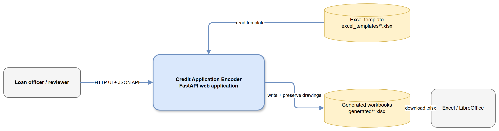
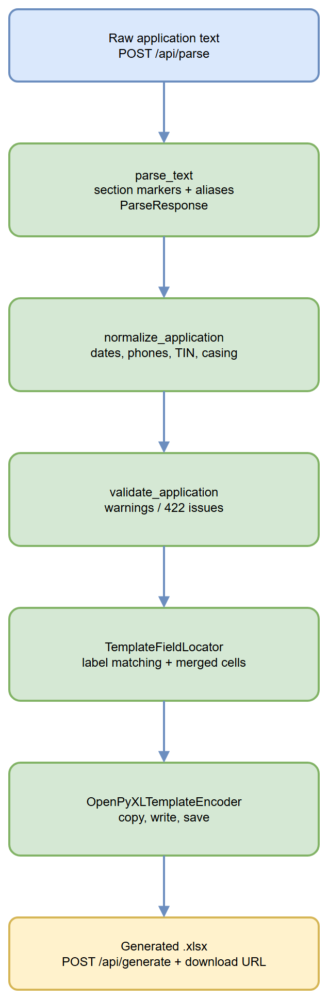
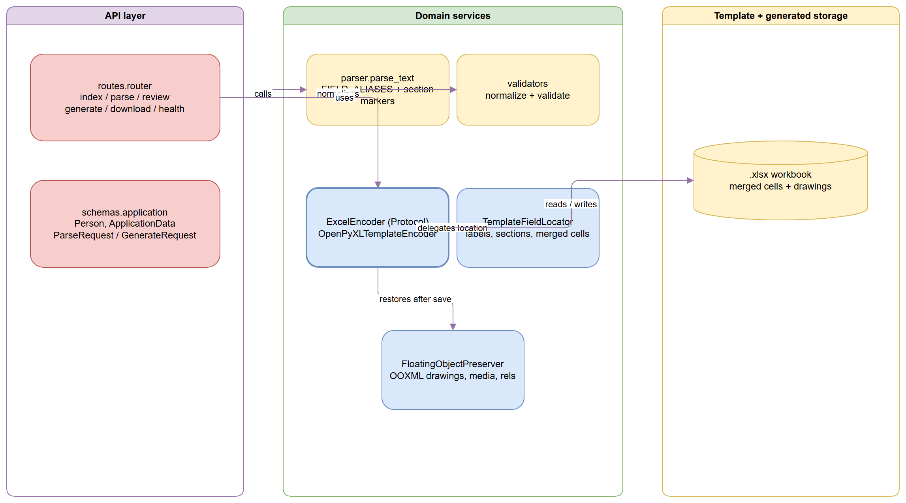

# 1. Executive Summary

Credit Application Encoder is a Dockerized FastAPI application that turns semi-structured credit application text into a completed copy of an Excel template. It parses borrower and co-maker sections, maps label variants to a stable schema, normalizes common formats, reports warnings and validation issues, and writes recognized values into the supplied workbook. It preserves merged-cell destinations and template OOXML drawing parts that `openpyxl` may not round-trip.

# 2. Architecture Overview



`app/main.py` registers the FastAPI app, static assets, and routes. The browser submits raw text to `/api/parse`, reviews normalized `ApplicationData`, then submits `/api/generate`. Generated workbooks are stored under `generated/` and downloaded through `/api/download/{filename}`. `/health` reports template existence and workbook structure.

# 3. Processing Pipeline



1. `ParseRequest` accepts non-empty `raw_text`.
2. `parse_text` recognizes borrower and co-maker section markers, parses `LABEL: value` and `LABEL#value` lines, supports continuation lines, and records warnings, conflicts, and source values.
3. `normalize_application` formats dates as `MM/DD/YYYY`, groups phone numbers and nine-digit TINs, lowercases email addresses, and uppercases most text fields.
4. `validate_application` checks real date formatting and recognized housing statuses. Generation returns HTTP 422 for issues unless `accept_errors` is true.
5. `TemplateFieldLocator` resolves labels through `FIELD_ALIASES`, section boundaries, explicit age destinations, merged-cell rules, and occupied-adjacent-label fallback behavior.
6. `OpenPyXLTemplateEncoder` writes a timestamped workbook copy, refuses to generate when no recognized labels were written, and invokes `FloatingObjectPreserver` after saving.

# 4. Core Components



| Component           | Responsibility                                                           | Location                           |
| ------------------- | ------------------------------------------------------------------------ | ---------------------------------- |
| FastAPI application | Static files, templates, and route registration                          | `app/main.py`                      |
| Route layer         | Browser pages and parse/generate/download/health endpoints               | `app/api/routes.py`                |
| Domain schema       | Pydantic request, response, and application models                       | `app/schemas/application.py`       |
| Parser              | Section-aware text extraction and alias resolution                       | `app/services/parser.py`           |
| Field map           | Canonical fields and accepted labels                                     | `app/services/field_map.py`        |
| Validators          | Normalization and validation rules                                       | `app/services/validators.py`       |
| Encoder port        | Replaceable workbook-writing contract                                    | `app/services/excel_encoder.py`    |
| Template locator    | Label matching and writable-cell resolution                              | `app/services/excel_encoder.py`    |
| OOXML preservation  | Restores drawings, media, relationships, and worksheet object references | `app/services/floating_objects.py` |

The `ExcelEncoder` protocol is the primary extension point. New label variants belong in `FIELD_ALIASES`; normalization rules belong in `correct_value_format`; workbook placement rules belong in `TemplateFieldLocator`.

# 5. API Contracts and Message Schemas

| Method | Path                       | Input                                  | Output / behavior                                                    |
| ------ | -------------------------- | -------------------------------------- | -------------------------------------------------------------------- |
| GET    | `/`                        | Browser request                        | HTML entry page and template availability flag                       |
| POST   | `/api/parse`               | `{ "raw_text": string }`               | `ParseResponse` with data, warnings, conflicts, and source values    |
| GET    | `/review`                  | Browser request                        | HTML review page                                                     |
| POST   | `/api/generate`            | `ApplicationData` plus `accept_errors` | Filename and download URL; 422 for validation issues unless accepted |
| GET    | `/api/download/{filename}` | Generated filename                     | Excel file; 404 if missing or outside generated storage              |
| GET    | `/health`                  | None                                   | Status and inspected workbook metadata                               |

`ApplicationData` contains `unit`, two preferred colors, and `applicant` and `spouse` `Person` objects. `Person` stores identity, contact, residence, employment, banking, and TIN fields. Both models allow extra fields for forward compatibility.

# 6. Infrastructure and Deployment

The `Dockerfile` uses `python:3.12-slim`, installs `requirements.txt`, copies the application, creates `generated/`, and starts Uvicorn on port 8000. `compose.yaml` publishes port 8000, mounts `./generated` as writable output, mounts `./excel_templates` read-only, and supplies `GENERATED_DIR` and `TEMPLATE_PATH`.

```text
docker compose up --build
```

There is no external database or message broker. Durable inputs and outputs are filesystem volumes. Production deployment should protect generated-file access and ensure the template volume contains the expected workbook.

# 7. Extension Patterns

To support a new customer label, add it to the relevant canonical entry in `app/services/field_map.py`, then add parser and Excel output tests. To add normalization, update `correct_value_format` and cover the normalized value and validation behavior. To support another workbook format, implement `ExcelEncoder.encode(template_path, output_dir, data)`. To support a new drawing or embedded-object type, extend the package prefixes and worksheet object restoration logic in `FloatingObjectPreserver`.

# 8. Rules and Anti-Patterns

The writer must not silently produce an unmapped workbook; it raises when no recognized labels were written. Prefer alias-based label matching over fixed coordinates, except for documented explicit destinations such as age fields. Always write to a generated copy. Keep download candidates inside `GENERATED_DIR`. Treat new template object types as a compatibility change and visually verify them in Excel or LibreOffice.

# 9. Dependencies

| Category            | Packages                                    |
| ------------------- | ------------------------------------------- |
| Web API             | `fastapi==0.115.6`, `uvicorn==0.34.0`       |
| Templates / forms   | `jinja2==3.1.5`, `python-multipart==0.0.20` |
| Workbook processing | `openpyxl==3.1.5`, `Pillow==11.1.0`         |
| Testing             | `pytest==8.3.4`, `httpx==0.28.1`            |

# 10. Code Structure

| Path                         | Purpose                                                                      |
| ---------------------------- | ---------------------------------------------------------------------------- |
| `app/main.py`                | FastAPI application setup                                                    |
| `app/api/routes.py`          | HTTP and HTML endpoints                                                      |
| `app/core/config.py`         | Environment-backed paths                                                     |
| `app/schemas/application.py` | Pydantic contracts                                                           |
| `app/services/`              | Parser, validators, field map, Excel writer, encoder, and OOXML preservation |
| `app/web/`                   | Templates and static browser assets                                          |
| `tests/`                     | Parser, validator, and Excel output tests                                    |
| `excel_templates/`           | Source workbook mount                                                        |
| `generated/`                 | Generated workbook output                                                    |

## Verification Notes

This summary was generated from the repository code graph and spot-checked against the route, schema, parser, validator, encoder, preservation, deployment, and test files. No credentials or connection strings are included.
